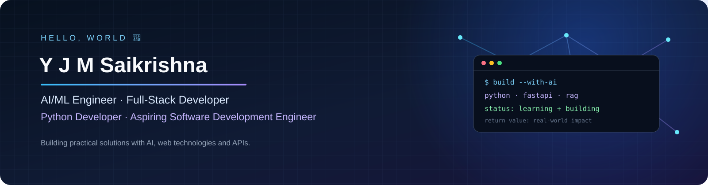

# Yemineni Jyothi Madhava Saikrishna

### AI/ML Engineer · Full-Stack Web Developer · Python Developer · Aspiring Software Development Engineer

Building practical applications with Python, APIs, machine learning, and web technologies.

  
  
  
  

---

## 💻 Coding Profiles

  
  
  

---

## 👨‍💻 About Me

- 🎓 Computer Science engineering student focused on software development and applied AI.
- 🔭 Building **ResolveAI**, an AI-powered customer-support assistant using Retrieval-Augmented Generation (RAG).
- 🧩 Built backend APIs with **FastAPI and MongoDB**, including attendance workflows and analytics.
- 🤝 Interested in collaborating on AI/ML, Generative AI, backend, and full-stack projects.
- 💬 Topics I enjoy: Python, FastAPI, ML fundamentals, RAG, SQL, MongoDB, Java, React, and REST APIs.

## 🌱 Currently Learning

| Focus area | Current learning goals |
|:--|:--|
| **DSA & Java** | Strengthening problem-solving, data structures, algorithms, and interview patterns |
| **AI / Machine Learning** | Model training and evaluation, feature engineering, deep learning, and practical ML projects |
| **Generative AI** | RAG pipelines, embeddings, semantic search, and evaluation of AI applications |
| **Full-Stack Development** | React, Node.js, Express, API integration, authentication, and deployment |
| **Core CS & SQL** | Operating systems, computer networks, DBMS, SQL queries, and interview fundamentals |

## 🛠️ Tech Stack

  

  
  
  
  
  

---

## 🚀 Featured Projects

<table>
  <tr>
    <td width="50%" valign="top">
      <h3>🤖 <a href="https://github.com/YJMSK-2006/Supervity-Customer-Support-AI">ResolveAI — Customer Support AI</a></h3>
      
RAG-based support assistant that retrieves relevant knowledge-base content to help answer user questions.

      
<strong>Tech:</strong> Python · FastAPI · Embeddings · sentence-transformers

      <a href="https://github.com/YJMSK-2006/Supervity-Customer-Support-AI">View repository →</a>
    </td>
    <td width="50%" valign="top">
      <h3>📊 <a href="https://github.com/YJMSK-2006/HROne-Attendance-Analytics-API">Employee Attendance & Analytics API</a></h3>
      
REST API for employee records, punch-in/punch-out, attendance corrections, audit history, and reporting.

      
<strong>Tech:</strong> Python · FastAPI · MongoDB

      <a href="https://github.com/YJMSK-2006/HROne-Attendance-Analytics-API">View repository →</a>
    </td>
  </tr>
  <tr>
    <td width="50%" valign="top">
      <h3>🔐 <a href="https://github.com/YJMSK-2006/SQL_Injection_Detection">SQL Injection Detection</a></h3>
      
Machine-learning project exploring classification of potentially malicious SQL queries versus legitimate inputs.

      
<strong>Tech:</strong> Python · Machine Learning · Scikit-learn

      <a href="https://github.com/YJMSK-2006/SQL_Injection_Detection">View repository →</a>
    </td>
    <td width="50%" valign="top">
      <h3>🧪 More Projects</h3>
      
Explore my repositories for additional experiments, coursework, and development projects.

      <a href="https://github.com/YJMSK-2006?tab=repositories">Browse all repositories →</a>
    </td>
  </tr>
</table>

---

## 🏅 Certifications & Virtual Experience

- **AICTE TechSaksham (Microsoft & SAP)** — completed an AI-powered resume screening and candidate-ranking project.
- **Cisco Data Analytics Essentials** — foundational data analytics learning.
- **Forage Virtual Experiences** — Walmart USA Advanced Software Engineering and Accenture Software Engineering.
- **Google Cloud Skills Boost** — earned 8 skill badges.

Credentials and experience details can be verified through the corresponding certificates and program pages.

## 🎯 Current Focus

- Build and improve portfolio projects with clear documentation, tests, and deployment instructions.
- Practice Java and DSA consistently for software engineering interviews.
- Develop practical AI/ML and RAG applications, with attention to evaluation and reliability.
- Strengthen full-stack skills by shipping complete, usable applications.

## 📌 Explore My Work

- **Repositories:** [Browse all projects](https://github.com/YJMSK-2006?tab=repositories)
- **Coding practice:** [LeetCode](https://leetcode.com/u/yjmsaikrishna_2006/) · [CodeChef](https://www.codechef.com/users/saikrishnay_19) · [GeeksforGeeks activity](https://www.geeksforgeeks.org/profile/saikrishn6wno?tab=activity)
- **Professional profile:** [LinkedIn](https://www.linkedin.com/in/j-m-saikirshna-y/)

---

## 📈 GitHub Analytics

## 🐍 Contribution Snake

The snake animation is generated by GitHub Actions. After the workflow succeeds, the SVGs are published to the `output` branch and appear below.

  <picture>
    <source media="(prefers-color-scheme: dark)" srcset="https://raw.githubusercontent.com/YJMSK-2006/YJMSK-2006/output/github-contribution-grid-snake-dark.svg" />
    <source media="(prefers-color-scheme: light)" srcset="https://raw.githubusercontent.com/YJMSK-2006/YJMSK-2006/output/github-contribution-grid-snake.svg" />
    
  </picture>

---

## 🤝 Let's Connect

I'm open to learning, building, and collaborating on useful software projects.

  
  
  

<i>Learn continuously. Build consistently. Improve every day.</i>

